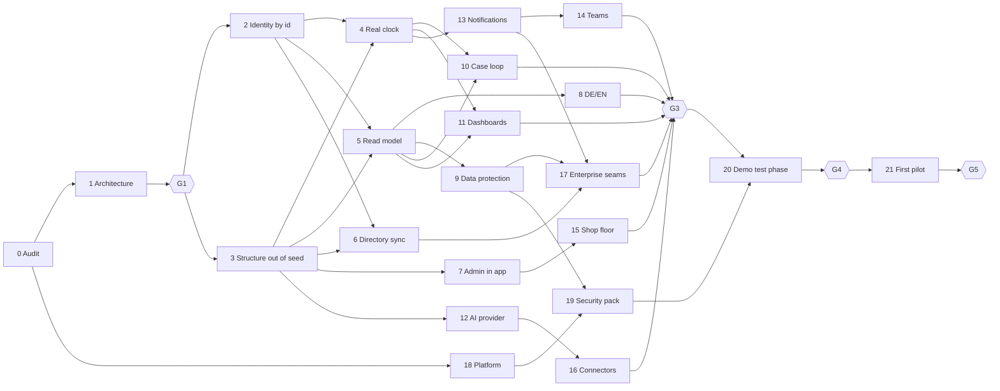

# Master plan: from today's build to a pilot-ready product

> **Plan · 2026-11-01 · in progress. Status 9 Nov, from the team report "Where we stand" v1.4 (nextup-context `reports/2026-11-08_where-we-stand/`): gates G1–G3 are done in effect (1–4 Nov), gate G4 (test phase) is open with 0 of 8 exit criteria formally signed off, G5 (pilot review) has not started. Phase 0 (audit) is done: the gap register is in [../audit/gap-register.md](../audit/gap-register.md).**
> The rough plan (L0) for everything between `main` as of 1 Nov (984f3b0, #249) and the first pilot with a company
> of 1,000–2,000 employees. Each phase below gets its own detailed plan before it is built. Why this order and
> this segment: [2026-11-01_segment-analysis.md](2026-11-01_segment-analysis.md).

## Executable version: orch Hauptplan PILOT

The phases below are the overview. The version orch runs is the Hauptplan `PILOT` in `selluxhenner/plans`
(`projects/nextup/hauptplaene/PILOT.md`), with one brief per phase (result, done when, acceptance test, code
area, what it takes and hands on). Each phase there becomes one Bauplan. It recuts the phases to orch size and
changes the order in two places: company structure (STR) comes before identity by id (IDN), because role holders
are structure tables, and German/English (LNG) comes early, so later UI phases write both languages from the start.

| Here | PILOT | Here | PILOT |
| --- | --- | --- | --- |
| 0 Audit | AUD | 11 Dashboards | MET |
| 1 Architecture | ARC | 12 AI provider | AIP |
| 2 Identity by id | IDN | 13 Notifications | NTF |
| 3 Structure out of seed | STR | 14 Teams | TMS |
| 4 Real clock | CLK | 15 Shop floor | FLR |
| 5 Read model | VIS | 16 Connectors | CON |
| 6 Directory sync | DIR | 17 Enterprise seams | API + EID |
| 7 Admin in app | ADM | 18 Platform | OPS (+ INF, parked) |
| 8 DE/EN | LNG | 19 Security pack | SEC |
| 9 Data protection | GDP | 20 Demo test phase | TST |
| 10 Case loop | LOOP | 21 First pilot | PIL (package only; the pilot itself is not code) |

## Goal

At the end of these phases NextUp runs for one real company of 1,000–2,000 employees on its own server, with
real identities, a real clock, German and English, the company's Microsoft 365, Teams and Jira, and the
paperwork its IT and works council ask for. Before any pilot, the whole system is tested hard with a realistic
demo company. After that the first pilots start.

The second goal shapes every phase: **NextUp plugs into a large company's systems instead of becoming another
island.** Identities come from their identity provider, the org from their directory or HR system, messages go
to their channels, work goes to their trackers, knowledge stays where it is, logs go to their SIEM, and the AI
can run in their own tenant. For the pilot we build the Microsoft 365 adapters; for a corporate we add adapters
behind the same interfaces, without touching the core.

**In scope:** the product core, identity and org, administration, data protection, channels, connectors,
platform and security, a demo test phase, the pilot package and the first pilot.

**Not in scope:** SAP, ServiceNow and PLM adapters (only their interfaces), TISAX assessment, own mobile apps,
idea voting, reward scheme, 24/7 operations, high availability.

## Done when

- A demo company with 1,500 people passes the test phase (phase 20) on a dedicated server, against a Microsoft
  365 test tenant and a Jira test site.
- One pilot company runs on stage `pilot` for 6 weeks and its numbers are measured (phase 21).
- Every interface named in "Integration principles" exists as a versioned contract with at least one adapter.

## What is built today (audit of 2026-11-01)

Two read-only audits of `origin/main` in Nextup, nextup-admin and nextup-infra. Phase 0 re-checks every line and
turns it into a gap register. Status: **live** = on and used · **off** = built, off by default · **partial** ·
**missing**.

### Five findings that change the order of work

1. **The clock is a demo counter.** Every deadline runs on `Company.demoDay`, which only moves through a
   `day.advanced` event, and `server/actions/events.ts` refuses that outside the `demo` stage. On a real company
   the 5-day promise, deputy escalation, check-ins and the 30/90-day measures never fall due. Escalation is
   computed at render time, never written as an event.
2. **People are matched by display name.** Inbox, assignee and actor compare name strings
   (`selectors.ts` `inboxFor`). A user created by Entra just-in-time does not match a route owner from the seed.
3. **Every browser gets the whole case log.** `(app)/layout.tsx` sends all events and the seed to every signed-in
   user; `visibility.ts` says "Browser only for now".
4. **Structure and demo content are one blob.** `Company.seedJson` holds org, routes, goals and demo cases
   together; acme's goals, the "€5k" spend rule and acme's routes leak into empty companies (`EMPTY_SEED`).
5. **Real customer data has nowhere to go yet.** The shared Hetzner box is demo-only by rule, and deploy, agent
   and health checks all assume that box. There is no dedicated-VM path, no off-box backup, and `release` takes
   no backup before migrating.

### Product

| Area | Status | Evidence | Main gap |
| --- | --- | --- | --- |
| Raise, idea studio, coach, drafts | live | `features/ideas`, #219, #223, #228 | parts of the raise menu are placeholders |
| Routing: keyword proposal, AI proposal, override | live | `features/routing`, brain `/v1/route`, `case.override` | proposal is sent by the client; `aiRouting` flag never read |
| Routing table and org | partial | written once at company creation | no routing or org editor; settings read-only |
| 5-day clock, deputy | demo only | `config/site.ts`, reducer | finding 1 |
| Inbox, decision log | live | `inboxFor`, append-only `CaseEvent` | finding 2 |
| Discussion, projects, Kanban, measure, reward | off | flags `discussion`, `projects`; #212, #214, #224 | timers on the demo clock |
| Wait ledger, dashboards, feed | partial | `features/metrics`; `dashboardPreview.ts`, `feedPreview` | placeholder data; "—" without demo data |
| Login codes | live | `features/auth/login-code.ts` | signup, invite, reset are stubs |
| Entra OIDC, app roles, JIT | live | #233–#235 | JIT sets no department, handle or role holder |
| Directory sync (Graph, SCIM), deprovisioning | missing | SSO plan phases 3–4 | no delete-user action at all |
| In-app settings | partial | `settings/members` works | `settings/company` empty, `settings/routing` read-only |
| Email notices | live with `SMTP_URL` | `case-notice.ts`, `loop-notice.ts` | no digest; `notifications` setting never read |
| Teams, Slack, QR, kiosk, PWA | missing | – | – |
| German UI | missing | `<html lang="en">`, strings inline | – |

### Integrations

| Area | Status | Evidence | Main gap |
| --- | --- | --- | --- |
| Events API (pull, tokens, scopes, idempotency, cursor) | live | `api/[company]/events` | no version, no rate limit, returns every event |
| Outbound webhooks, outbox | missing | docs say "pull, not push" | – |
| Knowledge documents import | live | `api/[company]/knowledge/documents` | full-text only, no chunks or vectors |
| Jira sync inside the app | off | #245–#249, `server/jira-sync.ts` | Cloud only, Data Center throws |
| Microsoft 365 search, sealed per-person tokens | off | `Connection`, `features/m365/search.ts`, #243, #244 | needs the assistant on; ground truth not run |
| n8n | templates only | `ops/n8n/*.json` | no deadline or digest workflow |
| Connector abstraction | partial | `Integration` table, `JiraApi` seam | no shared interface |
| `packages/contracts` | internal only | stack ↔ admin schemas | no customer API contract, no OpenAPI |

### AI

| Area | Status | Evidence | Main gap |
| --- | --- | --- | --- |
| Assistant on Bedrock eu-central-1, redaction, DPA gate | off | `server/assist/provider.ts`, `features/assist/redact.ts` | no AWS account on any stack |
| Brain (route, coach, plan, check-in), OpenAI-compatible | live on demo | `services/brain` | shared CPU server, ~10 users max; coach skips the DPA gate |
| Eval set | partial | `services/brain/eval`: 32 ideas | brain eval not in CI |

### Data protection

| Area | Status | Evidence | Main gap |
| --- | --- | --- | --- |
| Write permissions, tenant guard | live | `mayAppend`, `lib/db/scope.ts`, isolation tests | – |
| Read visibility | missing on server | `visibility.ts` | finding 3 |
| Audit log | partial | domain events have actors | admin actions only to `console` |
| Export, deletion, retention | partial | company delete exists | no data export, no person deletion, no retention for events and drafts |
| No person metrics | partial | drafts private, roles to the model | "most relied-on contributors" ranking, `/people/[name]` counts |
| Company `/admin` access | partial | Entra `NextUp.Admin` works | shared `ADMIN_ACCESS_CODE`, no 2FA |

### Platform and operations

| Area | Status | Evidence | Main gap |
| --- | --- | --- | --- |
| One compose stack per company, `install.sh`, hardened app container | live | `stack/compose.yml` | `:latest` tags, no digests |
| CI, Trivy, staging, smoke, approval, rollback | live | `.github/workflows` | one approver; no backup before `release` migrates |
| Provisioning from admin through the box agent | live, shared box only | `stack/provision/agent.sh` | no remote VM, no on-prem agent |
| Dedicated VM per customer, IaC | missing | stage-2 trigger | nextup-infra holds only secrets |
| Backups (restic, weekly restore test) | live, same disk | `stack/backup.sh` | no off-box target, no RPO/RTO |
| Monitoring (health to admin, error tickets, box checks to ntfy) | live | `health-report.ts`, `health.sh` | no external uptime, no central logs, one recipient |
| Server hardening | built, not on main | `nextup-infra/servers/harden.sh` uncommitted | not applied |
| Team access to customer stacks | standing | agent copies stack secrets into admin's vault | no customer-granted break-glass |
| Load test, sizing | missing | – | no figure for users per stack; no pooler |
| Compliance documents (DPA, TOMs, DPIA, works agreement, VDA ISA) | missing | only `docs/customer/ENTRA_SETUP.md` | – |

### Tests

About 950 unit tests (vitest, in CI), about 67 DB tests (CI job `db-tests`, see `docs/audit/ci-baseline.md`), about 44 e2e tests (demo suite,
DB login suite, visual), a fake Jira. Seed: acme with 5 users and 9 cases.

## Integration principles

Every external system sits behind one of these interfaces. A new system is a new adapter; the core does not
change. The interfaces are defined in phase 1 and are versioned from then on.

| Interface | What it does | Pilot adapter | Corporate adapters later |
| --- | --- | --- | --- |
| Identity | who is logging in, with which role | Entra OIDC (built) | generic OIDC (ADFS, Okta), SAML |
| Directory | people, org units, managers, deputies, leavers | Microsoft Graph delta sync | SCIM inbound, SAP SuccessFactors, Workday |
| Notify | messages to a person or a channel | email, Microsoft Teams | Slack, Webex, intranet |
| Case source | cases that start elsewhere | web, Teams, QR code | ServiceNow, SAP QM (8D), PLM (ECR/ECN) |
| Work tracking | decided work goes out, progress comes back | Jira Cloud (built) | Jira Data Center, Azure DevOps, Polarion |
| Knowledge | read company documents with the source's permissions, no copy | Microsoft 365 search (built) | Confluence, file shares through an on-prem connector |
| Log export | audit events to the customer's security team | JSON file and syslog | Splunk, Sentinel |
| AI provider | where the model runs | Bedrock eu-central-1, or off | Azure OpenAI in the customer's tenant, customer endpoint |
| Public API and webhooks | the customer's middleware reads and writes | API v1 with OpenAPI, signed webhooks | MuleSoft, SAP BTP, Azure Integration Services through the same API |

Rules that come with it:

- One canonical model inside NextUp (person with a stable id, org unit, role, role holder, case, decision,
  project). Adapters map to it; per-company mapping lives in configuration.
- Contracts are only extended, never broken. A breaking change is a new version that runs next to the old one.
- Pull and push both exist: the events API for pulling, an outbox with signed webhooks for pushing.
- The core loop (raise → route → answer → decide) works with every adapter and the AI switched off.

## Phases

22 phases in six blocks. Sizes are rough person-weeks (PW) of classic effort, meant as relative sizes; the team
has built similar blocks faster with agents. Lane: who leads (K = Kevin, back-end and platform; S = Sam,
front-end; V = Victor, AI and automation).

### Block A: Check and design

| # | Phase | Result | After | Lane | PW |
| --- | --- | --- | --- | --- | --- |
| 0 | **Audit and gap register** | every line of the audit re-checked, all test suites run (incl. DB tests and brain pytest), one gap register where each gap has severity, phase and owner; this plan corrected where the register says so | – | K | 1 |
| 1 | **Integration architecture and contracts** | decision records for the canonical model, the nine interfaces, public API v1, webhook and outbox design, event versioning, config-not-code rule; the contracts written in `packages/contracts`, no runtime change | 0 | K | 2 |

Gate G1 (Kevin): the gap register and the architecture are approved. Everything after builds on them.

### Block B: Foundation (the core is rebuilt for real companies)

| # | Phase | Result | After | Lane | PW |
| --- | --- | --- | --- | --- | --- |
| 2 | **Identity by id** | inbox, assignee, actor and permissions use user ids and role holders, not names; every member gets a handle; existing events migrated | 1 | K | 3 |
| 3 | **Company structure out of the seed** | org units, roles, holders, routes, goals and rules in their own tables; demo content separate; acme's goals, spend rule and routes no longer leak; `CompanyConfig` fields actually read | 1 | K | 3 |
| 4 | **Real clock and scheduler** | working-day clock with a calendar per company or site, a scheduler job (lease, like `jira-sync`) that writes deadline, deputy, check-in and measure events; the demo keeps a simulated clock | 2, 3 | K | 2 |
| 5 | **Read model and server-side visibility** | projections instead of reducing the whole log on every request; each user receives only what their role may see; paging; shared rate-limit store; connection pooler | 2, 3 | K | 3 |

Phases 2 and 3 can run in parallel if their files are split in phase 1. Gate G2 (auto): the demo company runs on
ids, real tables and the real clock, and the e2e suite is green.

### Block C: Administration and data protection

| # | Phase | Result | After | Lane | PW |
| --- | --- | --- | --- | --- | --- |
| 6 | **Directory sync** | Graph delta sync of users, groups and managers; deputies from the manager chain; leavers deactivated; delete-user; JIT fills department and role holder; SCIM inbound seam | 2, 3 | K | 3 |
| 7 | **Administration in the app** | company, members, org and routing editor, calendar and connector settings for company admins; onboarding wizard; named admins with SSO or 2FA; shared admin code only as logged break-glass | 3 | S | 4 |
| 8 | **German and English** | every screen, mail and date in DE and EN, locale per user; German first for the pilot | 5 | S | 3 |
| 9 | **Data protection functions** | complete audit log incl. admin actions; data export per company and person; person deletion or pseudonymisation; retention rules for events and drafts; person rankings removed; screenshot policy per company | 5 | K | 3 |

### Block D: Product complete

| # | Phase | Result | After | Lane | PW |
| --- | --- | --- | --- | --- | --- |
| 10 | **Case loop v1** | placeholders in the raise menu removed or finished; discussion and projects switchable per company; override visible; loop tested with AI and integrations off | 4, 5 | S | 3 |
| 11 | **Wait ledger and management dashboards** | dashboards and feed on real data, baseline measurement before the pilot, export, no person metrics | 4, 5 | S | 3 |
| 12 | **AI provider and quality** | provider chosen per company (Bedrock EU, Azure OpenAI, customer endpoint, off); routing proposal made on the server; DPA gate also for the coach; eval set of 80+ cases, ⅓ German, in CI; override rate tracked | 3 | V | 3 |

### Block E: Channels and connectors

| # | Phase | Result | After | Lane | PW |
| --- | --- | --- | --- | --- | --- |
| 13 | **Notification engine and webhooks** | one outbox for all outgoing messages; channel adapters (mail, Teams, webhook); digest and reminders; gated by stage and opt-in; signed outbound webhooks for customers | 4 | K | 3 |
| 14 | **Microsoft Teams** | Teams app: notifications, raise a case from Teams, answer from an adaptive card | 13 | V | 3 |
| 15 | **Shop-floor access** | installable web app, QR codes per area, shared-device mode with short login, for people without PC or mail | 7 | S | 2 |
| 16 | **Knowledge and work connectors** | Microsoft 365 search finished (PR B–D of the SSO plan), 21/21 ground-truth questions; Jira Cloud on in the pilot, Jira Data Center adapter; connector template for the next system | 1, 12 | V | 4 |
| 17 | **Enterprise seams** | public API v1 with OpenAPI and rate limits; generic OIDC and SAML; SCIM inbound; log export (JSON, syslog); CSV bulk import and export | 6, 9, 13 | K | 4 |

Gate G3 (Kevin): feature-complete for the pilot. From here only fixes, no new features.

### Block F: Platform, trust and proof

| # | Phase | Result | After | Lane | PW |
| --- | --- | --- | --- | --- | --- |
| 18 | **Production platform per customer** | IaC for a dedicated VM (Hetzner DE, Azure variant); remote deploy without the shared box; off-box backups, backup before every migration, RPO/RTO written down; external uptime, central logs, alerts to more than one person; image digests, brain image in CI, second approver; `harden.sh` applied; on-prem install rehearsed | 0 | K | 4 |
| 19 | **Security and compliance pack** | no standing team access (customer-granted, logged break-glass); disk encryption and key rotation; external pentest or ZAP cycle; VDA ISA self-assessment; DPA, TOMs, processing record, DPIA, works agreement template; customer guides for install, operations and security | 9, 18 | K | 4 |
| 20 | **Demo test phase** | demo company "Musterwerk": 1,500 people, 3 sites, M365 test tenant, Jira test site, on a dedicated VM; scripted scenarios over simulated weeks plus two real weeks of internal use; load test with 2,000 accounts; restore and failure drills; bug bash | G3, 18, 19 | all | 4 |
| 21 | **Pilot package and first pilot** | onboarding runbook, training, support process, one-page offer, success metrics instrumented; install at the pilot company; sandbox, then pilot stage for 6 weeks; review against the pilot criteria | 20 | all | 3 + 6 weeks running |

Gate G4 (Kevin): the test phase is passed (exit criteria below). Gate G5 (Kevin and Marc): pilot review.
Phase 18 can start right after phase 0 and runs next to blocks B–E.

About 65 PW in total. Three part-time developers at roughly 2.5 FTE would need about six months at classic
speed; the real pace is known after blocks A and B.

### Order at a glance

## Which process is rebuilt in which phase

| Process | Today | Rebuilt in | Ready for a corporate through |
| --- | --- | --- | --- |
| Login | codes, Entra OIDC | 7 (named admins, 2FA) | 17 (generic OIDC, SAML) |
| Org and people | seed at company creation | 2, 3, 6 | 6 (SCIM seam), 17 (SCIM inbound) |
| Routing | keyword and brain proposal, read-only table | 3 (tables), 7 (editor), 12 (server-side AI) | config per company |
| Clock and escalation | demo counter | 4 | calendar per site |
| Raise | web, idea studio | 10, 14, 15 | case-source interface (1) |
| Answer and decide | inbox by name | 2, 5, 10 | – |
| Follow-up and projects | flags off, Jira Cloud | 10, 16 | work-tracking interface (1, 16) |
| Notifications | single mails | 13, 14 | notify interface (1, 13) |
| Knowledge | M365 search off | 16 | knowledge interface, on-prem connector later |
| Reporting | placeholder dashboards | 11 | API v1 and log export (17) |
| Data protection | write rules, partial audit | 5, 9, 19 | log export (17), customer-held keys later |
| Operations and release | shared box, CI, staging | 18 | on-prem rehearsal (18) |
| Support | tickets to admin.sellux.ch | 21 | SLA later |

## Test phase exit criteria (gate G4)

- All suites green in CI, including DB tests and the brain eval.
- 2,000 accounts: p95 below 1 s for inbox and case pages under the planned load; no page loads the whole log.
- Every deadline, deputy hand-over, check-in and measure in the scripted scenarios fires on the real clock.
- 21/21 ground-truth questions in the M365 test tenant; no document visible to someone without access.
- A member sees only what their role may see (tested on the server, not in the browser).
- Restore from the off-box backup within the written RTO; one on-prem install from scratch.
- No open finding rated high from the pentest or ZAP cycle.
- Two weeks of internal real-time use without a data-loss or access bug.

The numbers are proposals; phase 20's detailed plan fixes them.

## Decisions for every phase

| Id | Decision |
| --- | --- |
| HD1 | The goal is a product ready for a pilot with 1,000–2,000 employees. First a demo test phase that tests everything, then the first pilots. |
| HD2 | NextUp integrates into the customer's systems instead of building a parallel one. Every external system sits behind one of the interfaces above; a new system is a new adapter. |
| HD3 | Interfaces are versioned contracts. They are extended, never broken; a breaking change is a new version next to the old one. |
| HD4 | No company-specific logic in code. What differs between companies is configuration. |
| HD5 | Roles, not people: routing goes to roles, and there are no person rankings or person metrics. |
| HD6 | One stack per company, the same artefacts hosted or on-prem. Real customer data never goes on the shared demo box. |
| HD7 | The core loop works with the AI and every integration switched off. |
| HD8 | The AI provider is chosen per company, and "off" is a supported choice. |
| HD9 | Each phase gets its own dated plan in `docs/plans/` before it is built. |

## Open questions

| Id | Question | Default if nobody answers | Blocks |
| --- | --- | --- | --- |
| HQ1 | Do the detailed plans also become orch plans? `selluxhenner/plans` has no `nextup` project yet. | detailed plans in `docs/plans/`; orch only if Kevin creates the project | – |
| HQ2 | Is German required for the pilot? | yes, DE first, EN second | 8 |
| HQ3 | Where does the pilot run? | dedicated Hetzner VM in Germany; Azure variant only if the customer asks | 18 |
| HQ4 | Which AI for the pilot? | Bedrock eu-central-1 with a signed DPA; off as fallback | 12 |
| HQ5 | Which holiday calendar? | German federal plus state holidays per site | 4 |
| HQ6 | May existing events be rewritten from names to ids? | yes: only demo data exists today | 2 |

## Risks

- **The foundation phases touch everything.** Phases 2–5 change the reducer, events and every page. → They run
  first, one at a time where files overlap, with the full e2e suite as the gate.
- **Parallel sessions collide.** Earlier parallel work clashed on seed data and flags. → Phase 1 assigns file
  ownership per phase; an integration run with all e2e tests closes every block.
- **Scope grows with every customer conversation.** → After gate G3 only fixes; new wishes go to a list for
  after the pilot.
- **Compliance takes longer than code.** Legal entity, DPA and works agreement depend on people outside the
  team. → Phase 19's paperwork (DPA, TOMs, DPIA, works agreement, VDA ISA) starts right after phase 0, next to
  block B; only its technical part waits for phases 9 and 18.
- **The pilot company is not found in time.** → Marc's list of 10 companies runs from now; the test phase does
  not wait for it.
