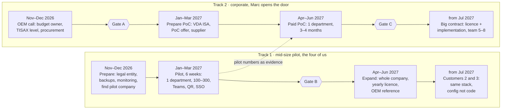

# Analysis: big corporate or mid-size company first?

> **Analysis · 2026-11-01 · open: Kevin and Marc still decide the order.** English version of the Claude Doc
> "NextUp: Grosskunde oder Mittelstand? Analyse & Bauplan". The build plan that follows from it:
> [2026-11-01_pilot-readiness.md](2026-11-01_pilot-readiness.md).

## Summary

**Recommendation: both goals, in this order.** First a paid pilot with a company of 1,000–2,000 employees,
built and run by the four of us. In parallel Marc opens the door to an automaker (OEM), with a paid proof of
concept in one department, not with a €1M build contract as the first step.

Kevin is right about the order and the risk: an OEM contract needs a legal company, TISAX, procurement,
pre-financing 5–10 people and integrations that a team of four cannot carry at the same time. Marc is right
about the ambition and that everything must be built OEM-ready from now on. Most of that is already true: one
stack per company, on-prem capable, Entra SSO, roles instead of people.

The big contract comes once pilot numbers exist (answer rate, waiting time, usage). Then as **licence plus
implementation**, so the platform stays ours and is not handed over as contract work.

## The two positions

Both paths are possible. They differ mainly in how long it takes until the first money arrives and how much we
carry alone before that.

| | Marc: corporate (OEM, e.g. Skoda, BMW, VW) | Kevin: mid-size (1,000–2,000 employees, ~€300–500M revenue) |
| --- | --- | --- |
| Deal | ~€1M for a 6-month build, 5–10 people | pilot in the low-to-mid five figures, then a yearly licence (assumption) |
| Buyer | a department inside a group; procurement, IT security and the group works council take part | CEO or management board, knows the processes, short decision path |
| Time to contract | long: supplier registration, TISAX, procurement (duration at VW/Skoda unknown) | short: one meeting with management can be enough |
| Obligations | TISAX label for anyone processing OEM data (TÜV Nord, SECJUR); SAP, ServiceNow, PLM integration | GDPR, DPA, works agreement, Microsoft 365 |
| What it proves | size, a reference, money for a team | that people actually use NextUp and decision makers answer |
| Biggest risk | we pre-finance people, the deal is delayed or dies; the platform belongs to the customer afterwards | small revenue per customer; one pilot alone does not finance a team |

The data-access research of 2026-10-20 reached the same conclusion: a mid-size company is much easier to win;
at an OEM, TISAX, procurement and the group works council slow down even a one-department pilot. On 2026-10-06
we set the target segment to large automotive groups; this analysis proposes to stage that, not reverse it.

## What is realistic for the four of us

**Realistic: a pilot with a ~1,000-employee company, built and run by us.** Not realistic: an OEM contract with
5–10 new people in the coming months without first settling the company, certification and financing.

We are three developers (Kevin back-end, Sam front-end, Victor AI automation) and Marc in sales, all next to
university. Since 2026-09-14 a lot has been built with AI agents: idea studio, case with a 5-day clock, inbox,
project space, Entra SSO, Jira, one Docker stack per company, release gate, backups. Building is not the
bottleneck. The bottlenecks cannot be programmed away:

| Bottleneck | Mid-size pilot | OEM contract |
| --- | --- | --- |
| Legal entity, liability, insurance | needed, doable in weeks | needed, plus supplier registration |
| Certification | IT questionnaire, TOMs, DPA | TISAX label; the assessment takes months |
| Support | office hours, ourselves | SLA, on-call, escalation paths |
| Integration | Microsoft 365, maybe Jira | SAP, ServiceNow, PLM, their own middleware |
| People | the four of us | hire, onboard and lead 5–10 people |
| Cash flow | pilot pays upfront or at start | group payment terms often 60–90 days (rough assumption); salaries run from day 1 |

**Rough maths for the €1M deal (estimate, no source):** 7 people × 6 months × ~€15,000 per person and month
(freelancer mix, fully loaded) ≈ €630,000. Plus TISAX preparation and assessment, insurance, legal, travel,
infrastructure. Little margin is left, and every delay is ours. Hiring 5–10 people within weeks also needs
someone to lead them; that would be Kevin, who would then hardly build anything himself.

## What is worth building now

**Rule of thumb: whatever strengthens the core and the trust base stays in every scenario. Whatever serves a
single company or the demo will be replaced.** A team of 5–10 would build on the core, not start over, as long
as the contracts between the parts (events API, contracts package, stack) stay stable.

**Stays, keep building:**

| Building block | Why it stays | State on 2026-11-01 |
| --- | --- | --- |
| Case core: event log, reducer, routing to roles, 5-day clock, deputy | it is the product and our IP | built |
| Wait ledger: time to first answer, share answered on time | the number we sell; pilot success criterion | partly |
| One stack per company, on-prem capable, signed releases | an OEM demands exactly that later | stage 1 built |
| Entra SSO, app roles, just-in-time accounts; plus group/org sync | both segments run Microsoft 365 | SSO built, sync open |
| Connector frame: one interface, source permissions kept, sealed tokens | single connectors change, the frame stays | in progress |
| Audit log, role permissions, "judge the case, never the person" | works council and GDPR; our moat | built |
| Security base: off-box backups, monitoring, hardening, ISMS documents | first step to TISAX; every IT questionnaire asks | open |
| AI behind a provider interface plus an eval set (80+ cases, ⅓ German) | the customer decides model and location later | interface there, eval open |

**Do not extend further, will be replaced:**

- Demo polish, static demo, dev panel: enough for conversations, adds nothing in a pilot.
- Our own project and Kanban management beyond the minimum: customers have Jira, Polarion or SAP. Integrate,
  don't rebuild.
- Our own GPU server (GEX45 decision): a group will prescribe Azure OpenAI in its own tenant or Bedrock. Keep
  only the interface clean.
- n8n as the only integration layer: fine for mid-size companies, an OEM wants its own middleware. The events
  API is the stable contract, n8n stays optional.
- Process logic for exactly one company in code: belongs in configuration (routing table, company rules,
  flags).

## What we should test now

**The biggest risk is not technology but whether decision makers answer within 5 days and employees raise
cases.** That can only be checked in a real department. The tests are sorted by risk; the targets are
proposals we still have to agree on.

| # | Risk | Cheapest test | Passed when (proposal) |
| --- | --- | --- | --- |
| 1 | Nobody uses it, decision makers don't answer | 4–6 weeks in one department of 100–300 people | ≥ 70 % of cases answered within 5 days; waiting time to first answer measurably lower |
| 2 | Routing proposes the wrong role | eval set with 80+ real or realistic cases, ⅓ German | override rate in the pilot below 30 % |
| 3 | Data access via Microsoft 365 fails with real permissions | test tenant with the 21 ground-truth questions (Acme test data); finish PR B and C | 21/21 correct, no document visible that the person may not see |
| 4 | The customer's IT rejects us | fill in the VDA ISA self-assessment (basis of TISAX) now and close gaps | filled in, open points with a date |
| 5 | The works council blocks | works agreement template plus DPIA; present it in the pilot | works council agrees to the pilot |
| 6 | The corporate deal is not real | one call by Marc with the OEM contact: budget owner, TISAX level, supplier process, timeline | four written answers |
| 7 | One stack cannot carry 2,000 people | load test on a test VM; restore test; on-prem install on a foreign VM | 2,000 accounts, stable response times, restore under 1 h |
| 8 | The customer rejects where our AI runs | ask in the first customer meeting: Bedrock Frankfurt, Azure in their tenant, or AI off | decided before the pilot starts |

Test 6 costs one call and decides the most about the strategy. If the OEM contact cannot name budget and path,
the €1M deal is a hope for now, not a plan.

## Connectors and integrations

**Five connections around Microsoft 365 are enough for the mid-size pilot; the expensive group integrations
(SAP, ServiceNow, PLM) come only with a paid contract.** Effort in person-weeks (PW) is a rough estimate for a
first usable version.

| Connection | What for | When | Effort | State |
| --- | --- | --- | --- | --- |
| Entra ID SSO (OIDC) | login, app roles, accounts at first login | pilot: must | – | built (#233–#235) |
| Entra / Graph: users, groups, managers | org chart and deputies without manual upkeep | pilot: must | 2–3 PW | open |
| Email (SMTP / Exchange) | notifications, deadline to deputy | pilot: must | – | built, domain mail open |
| Microsoft Teams: notify and raise | people work there, not in yet another app | pilot: must | 3–4 PW | open |
| Access without a PC: QR code, kiosk, phone | production staff often have no mail and no M365 seat | pilot: must | 1–2 PW | open |
| SharePoint / OneDrive read, source permissions | the assistant knows company knowledge | pilot: should | 3–4 PW | phase 2 partly built |
| Jira (Cloud / Data Center) | carry decided ideas on as projects | pilot: should | 1 PW | in-app sync engine (#245–#249) |
| SAML SSO (Okta, ADFS, Ping) | groups without Entra OIDC | OEM | 1–2 PW | open |
| ServiceNow | requests and tickets, common at OEMs | OEM | 4–6 PW | open |
| SAP SuccessFactors / SAP HR | org structure from HR instead of Entra | OEM | 4–6 PW | open |
| SAP QM, PLM (Teamcenter, Windchill) | 8D, ECR/ECN, deviation approval as cases | OEM | 6–10 PW each | open |
| SIEM export (syslog, Splunk) | the security team wants logs | OEM | 1 PW | open |

Mid-size companies often add an ERP (proAlpha, abas, SAP Business One) and an HR tool such as Personio. We
handle those per customer through the events API and n8n, without building them in advance.

## Pilot version for a company with ~1,000 employees

**Goal: within 8–10 weeks a version one department of 100–300 people can use daily, and which then grows to
the whole company without a rebuild.** Ideally an automotive supplier, so the automotive story for the OEM
path stays intact.

**In scope:**

- Raise a case: web, Teams and QR code; the coach helps to phrase it.
- Routing to roles through a routing table the department heads maintain themselves; AI proposes, a human
  confirms.
- 5-day clock with deputy, inbox for decision makers, decision log.
- Wait ledger as a dashboard for management, without person metrics.
- Decided cases as a simple project, to Jira on request.
- Settings in the app instead of /admin: members, company, routing editor.

**Operations and contract:**

- Own VM in Germany (Hetzner) or in the customer's Azure tenant; not the shared demo box.
- Entra SSO, off-box backups, external monitoring, restore test.
- DPA, TOMs, DPIA, works agreement template; AI can be switched off per company.
- Support during office hours with a named contact.

**Not in scope:** SAP, ServiceNow, PLM, own mobile app, idea voting, reward scheme.

**Success criteria after 6 weeks (proposal):** at least 1 case per 10 employees, ≥ 70 % answered within
5 days, override rate below 30 %, and management wants to roll out to further departments. These numbers are
also the strongest sales argument at the OEM.

## How a big contract would have to be set up

**Marc's €1M deal is the goal of track 2, not the entry.** Before it come a call that settles whether the deal
is real (gate A) and a paid PoC in one department, similar to the 4-month pilot of the BMW Startup Garage whose
aim is to become a supplier.

| Gate | Passed when |
| --- | --- |
| A | the OEM deal is real: budget owner, procurement path and TISAX level are known |
| B | pilot numbers reached: at least 70 % of cases answered within 5 days |
| C | contract signed and down payment received: only then hire |

Track 1 delivers the numbers Marc sells the PoC with; hiring starts only at gate C. The timeline is a
proposal with rounded dates.

**Team for the big contract (proposal, 5–8 people):**

| Role | Who |
| --- | --- |
| Product, architecture, customer lead | Kevin |
| Front-end plus 1–2 full-stack | Sam plus freelancers |
| AI, routing, eval | Victor |
| Integration SAP, ServiceNow, PLM | freelancer or a systems-integrator partner |
| DevOps, security, ISMS for TISAX | 1 person, freelancer possible |
| Rollout and change at the customer | Marc plus 1 |

**Contract conditions:**

- Licence and services separate; the platform stays with NextUp, the customer gets usage rights and their
  configuration.
- Payment by milestones, with a down payment before the first hiring decision.
- Freelancers first, permanent hires after the second milestone.
- Group integrations through a partner, so we don't have to build an SAP team.

## Next steps

**First three decisions between Kevin and Marc, then both tracks run in parallel.**

**Decisions:**

1. Order: mid-size pilot first, OEM as a paid PoC in parallel? (Recommendation: yes)
2. Pilot target: automotive supplier with 1,000–2,000 employees, or any industry? (Recommendation: supplier
   preferred, not required)
3. Principle for every big contract: licence plus implementation, the platform stays ours, down payment before
   hiring.

**Tasks:**

- [ ] Marc: call with the OEM contact; budget owner, TISAX level, supplier process, timeline in writing
- [ ] Marc: list of 10 companies with 1,000–2,000 employees, one management contact each
- [ ] Kevin: legal entity and liability insurance (prerequisite for any paid pilot)
- [ ] Kevin: fill in the VDA ISA self-assessment, gaps with a date
- [ ] Kevin: off-box backups, external monitoring, pilot VM template
- [ ] Kevin: Entra/Graph sync for users, groups, managers
- [ ] Sam: settings in the app (members, company, routing editor), Teams notification
- [ ] Victor: eval set with 80+ cases, ⅓ German; measure the override rate
- [ ] All: works agreement template and DPIA, a one-page pilot offer
