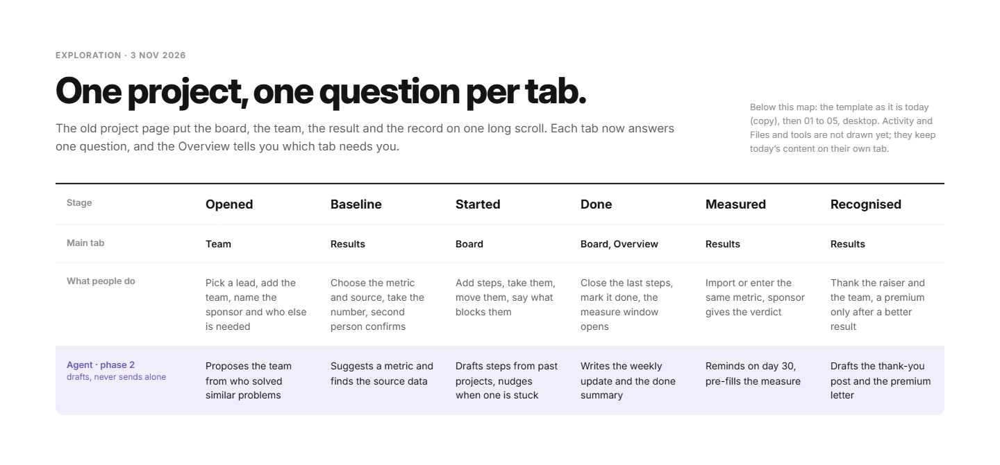
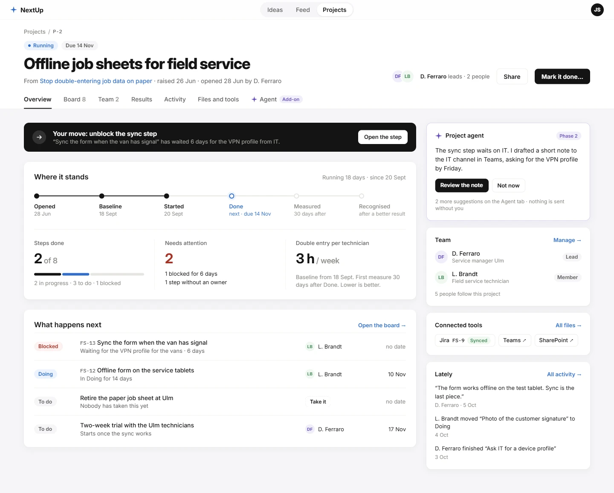
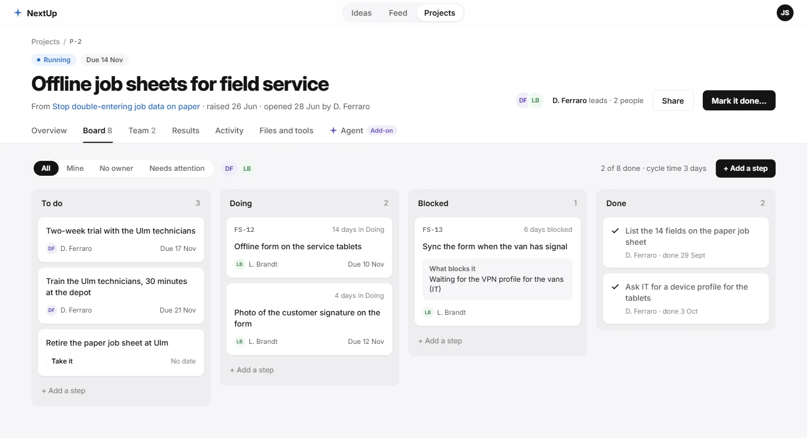
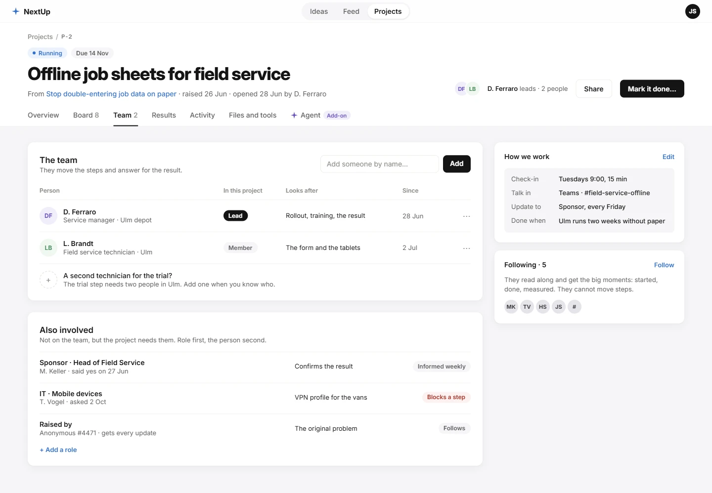
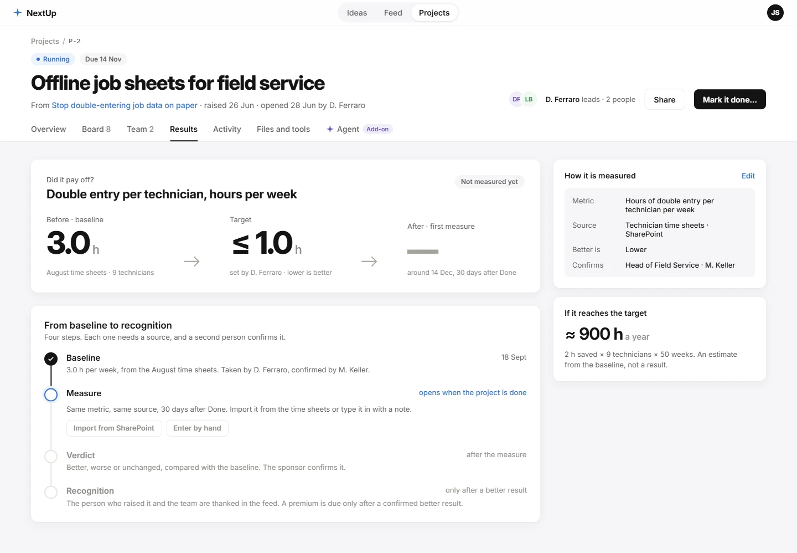
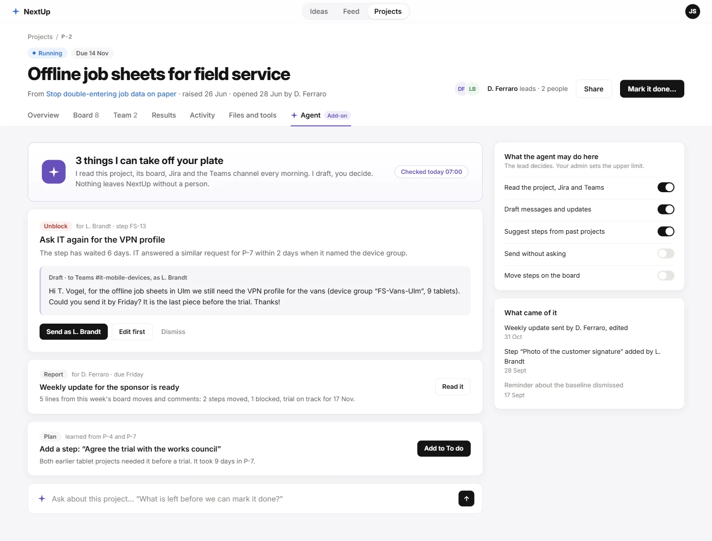

# Project area: one project, one question per tab

Design: [Project area · exploration in Paper](https://app.paper.design/file/01M55ZTX8WWCRJNW7898CQ7ECN/p-U-0)

> **Plan · 2026-11-03 · exploration, nothing built.** Kevin's proposal for the structure of the project page
> (`/[company]/projects/[projectId]`): split the one long page into tabs, and add an AI agent as a paid add-on in a
> second phase. It refines the "Project page" section of
> [spec 10](2026-11-02_pilot-pages/10-existing-pages.md#project-page) and keeps its rules. The structure is the
> proposal; the look is Sam's to decide.

## Why tabs

Today's page (`components/projects/ProjectView.tsx`) puts the header, the summary band, the board, Baseline, Measure,
Reward, Activity, The idea, Team, Connected tools and Files on one scroll. Every person who opens it has to find their
part. The board, the team and the result are different jobs done at different times by different people. They get
their own tab, and the Overview tells you which tab needs you.

The Paper page holds a copy of today's page (left) and the six artboards below.

## The map

| Stage | Main tab | What people do | Agent, phase 2 |
|---|---|---|---|
| Opened | Team | Pick a lead, add the team, name the sponsor and who else is needed | Proposes the team from who solved similar problems |
| Baseline | Results | Choose the metric and source, take the number, a second person confirms | Suggests a metric and finds the source data |
| Started | Board | Add steps, take them, move them, say what blocks them | Drafts steps from past projects, nudges when one is stuck |
| Done | Board, Overview | Close the last steps, mark it done, the measure window opens | Writes the weekly update and the done summary |
| Measured | Results | Import or enter the same metric, the sponsor gives the verdict | Reminds on day 30, pre-fills the measure |
| Recognised | Results | Thank the raiser and the team; a premium only after a better result | Drafts the thank-you post and the premium letter |

## Header and tabs (every tab)

Breadcrumb `Projects / P-2`, status and due badges, title, "From {idea} · raised … · opened … by …", faces with
"{lead} leads · {n} people", **Share** and the one primary action of the stage ("Mark it done…"). Below it the tabs:
**Overview · Board {n} · Team {n} · Results · Activity · Files and tools · Agent (Add-on)**.

## 01 Overview: what needs me?

- **Your move** banner: the one thing the viewer should do now, with a button to it.
- **Where it stands**: the six-stage track, then three facts: steps done (x of y, bar), needs attention (blocked,
  without an owner), baseline → latest measure. Cycle time and running days move to a small line.
- **What happens next**: the four steps that matter now (blocked first, then doing, then the next to do), each with
  state, owner and due; a step without an owner shows **Take it**.
- Rail: the agent's top suggestion (only with the add-on), Team, Connected tools, Lately (three newest events).

## 02 Board: the work

Full width, four columns that look the same. Colour means state only: "Due 12 Nov" in grey, a late date in red, a
blocked card shows "What blocks it" on a grey panel, a done card an ink check. Filters All, Mine, No owner, Needs
attention, one face per owner. Ticket keys in mono. Everything spec 10 keeps stays: drag and drop, composer per column,
the card sheet.

## 03 Team: who does what

- **The team**: person, role in the project (Lead, Member), what they look after, since when. No per-person count.
- **Also involved**: people the project needs who are not on the team, role first: sponsor, the IT contact a step
  waits on, the person who raised it. A badge says how they are involved ("Informed weekly", "Blocks a step").
- Rail: **How we work** (check-in, channel, who gets updates, done when) and **Following** (who reads along).

## 04 Results: did it pay off?

- Before, target, after in large numbers; "Not measured yet" until the measure exists.
- **From baseline to recognition**: Baseline → Measure → Verdict → Recognition, each with its source and the second
  person who confirms it. Measure opens 30 days after Done (import from SharePoint or enter by hand, as spec 11).
- Rail: how it is measured (metric, source, better is, confirms) and an estimate of what the target is worth, marked
  as an estimate.

## 05 Agent: add-on, phase 2

A project agent that reads the project, its board, Jira and the Teams channel once a day and suggests work. It
drafts; a person sends. Three kinds of suggestion are drawn: **Unblock** (a nudge to the person a step waits on, with
the draft text and the channel), **Report** (the weekly update for the sponsor), **Plan** (a missing step learned from
earlier projects). An ask box answers questions about the project.

The lead sets what it may do here, under a ceiling the company admin sets: read, draft, suggest steps are on;
**send without asking** and **move steps** are off. "What came of it" lists what people did with its suggestions.

## Not drawn yet

- **Activity** and **Files and tools** tabs: they keep today's content (comments and events newest first; the
  connected tools and the idea's files) on their own tab.
- **Phone** for every tab. On a phone the tabs scroll sideways; the Overview must show the title, the stage and the
  viewer's move on the first screen (spec 10).
- The planned state (before Start) and the measured and recognised states of Results.

## Open questions

1. **Routes.** One route per tab (`/projects/[id]/board`, `/team`, …) so a tab can be linked, or one page with a
   `?tab=` query? Kevin decides.
2. **New data.** "Also involved", "How we work", the target value and the followers list are not in
   `ReducedProject` today. Each needs a new `project.*` event; Kevin decides which ones come.
   *Answered 2026-11-03* in [the project setup plan](2026-11-03_project-setup.md): sponsor, followers and
   contributors (`project.sponsor`, a role on `project.member`), the target and "done when" (`project.goal`), how we
   work (`project.howwework`) and the brief (`project.brief`). "Also involved" people who are not on the team stay
   open; the sponsor covers the main case.
3. **Agent.** Needs its own events (suggested, accepted, dismissed), a permission per project and per company, and
   the brain on the server. It is phase 2: nothing in phase 1 waits for it.
